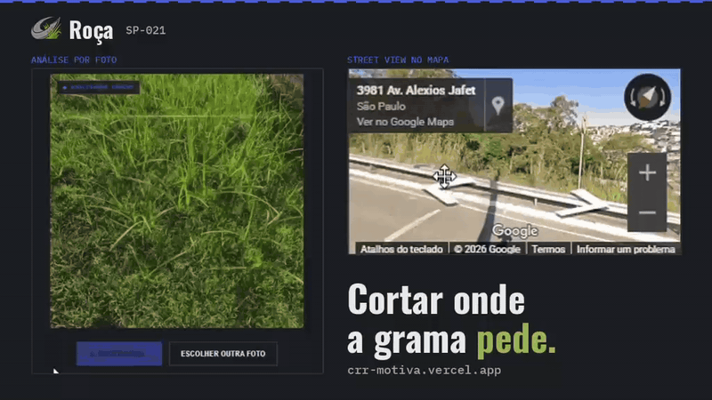
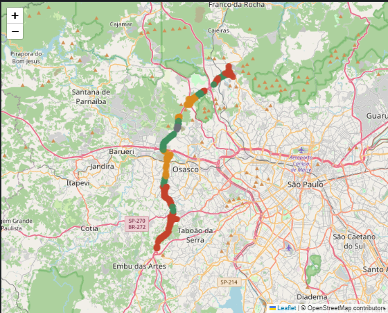
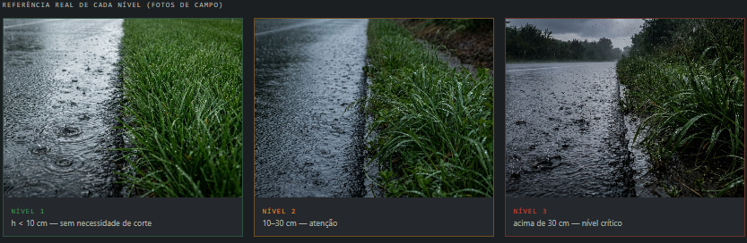
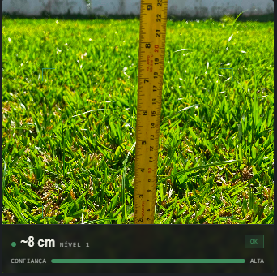
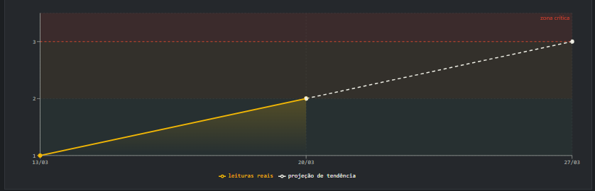
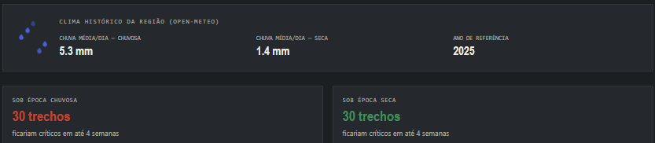
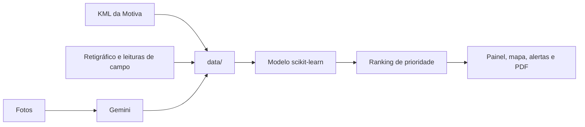
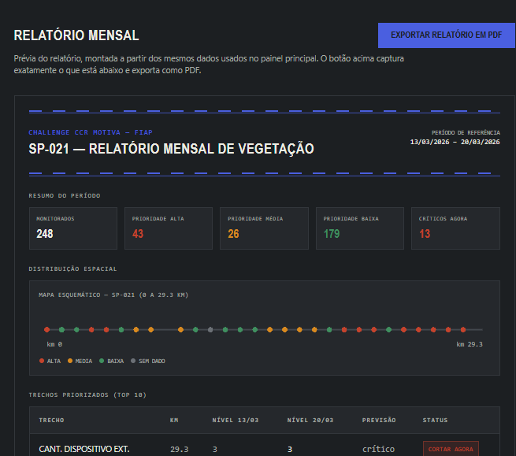

# Roça · SP-021

> Cortar onde a grama pede.



Plataforma de priorização de roçada para o Rodoanel Oeste (SP-021), desenvolvida no **Challenge CCR Motiva** da FIAP (turma 2CCPW, Grupo 28). Em vez de seguir um calendário fixo, o sistema usa dado real de campo para mostrar onde cortar primeiro.

**Deploy:** https://crr-motiva.vercel.app

## Índice

1. [O problema](#1-o-problema)
2. [A solução](#2-a-solução)
3. [Passo a passo do projeto](#3-passo-a-passo-do-projeto)
4. [Dados e banco de dados](#4-dados-e-banco-de-dados)
5. [Hardware e Edge Computing](#5-hardware-e-edge-computing)
6. [Stack](#6-stack)
7. [Como rodar localmente](#7-como-rodar-localmente)
8. [Estrutura do repositório](#8-estrutura-do-repositório)
9. [Links](#9-links)

## 1. O problema

A roçada na SP-021 segue um cronograma fixo, mas a vegetação não cresce em ritmo fixo. O resultado:

- roçada em trecho que ainda não precisava (custo);
- trecho crítico sem corte, com impacto em visibilidade e sinalização (segurança);
- detecção só na próxima inspeção (prazo e SLA);
- equipe que sai a campo sem saber onde o problema está.

## 2. A solução

O Roça monitora **29,3 km a cada 500 m**, a partir de leituras reais de campo (13/03 e 20/03), e transforma isso em decisão: um ranking de trechos por prioridade, um mapa, alertas e um relatório mensal.

| Entrada | Processamento | Saída |
|---|---|---|
| Leituras de campo por trecho (nível 1 a 3) e fotos | Estimativa de altura pela foto (Gemini) e modelo de taxa de crescimento por trecho (scikit-learn) | Mapa, painel, alertas e relatório indicando onde cortar primeiro |

No painel, com os dados reais: **248 trechos monitorados, 43 de prioridade alta, 26 média, 179 baixa e 13 críticos agora**.

<!-- Print do painel com as métricas: salve em docs/img/dashboard-metricas.png e descomente a linha abaixo. -->
<!--  -->

## 3. Passo a passo do projeto

### 3.1 Coleta de dados de campo

Cada trecho recebe leituras periódicas classificadas em três níveis de altura da vegetação. As duas leituras reais (13/03 e 20/03) permitem medir a **variação** de cada trecho, que é a base da priorização. Hoje a leitura é manual, e o ESP32-CAM com sensores (seção 5) é o caminho para automatizá-la.

### 3.2 Relevo da rota e dados geográficos

A rota usa os polígonos reais fornecidos pela Motiva (KML). Cada marco mostra o km e, ao ser tocado, os dados reais daquele trecho.



### 3.3 Mapa e API do Google Maps

O mapa (Leaflet) exibe os pontos de leitura. Ao clicar em um ponto, o **Street View** abre direto no painel, mostrando o local, o equipamento indicado para o trecho (por exemplo, trator com braço articulado) e o nível atual.


### 3.4 Os três níveis, uma ação para cada

| Nível | Altura | Ação |
|---|---|---|
| 1 | menor que 10 cm | OK: sem necessidade de corte no momento |
| 2 | entre 10 e 30 cm | AGENDADO: agendar corte nos próximos dias |
| 3 | maior que 30 cm | CORTAR AGORA: trecho em nível crítico |


Na tela de classificação, o usuário vê a referência de cada nível e as dicas de como tirar a foto:



### 3.5 Classificação por foto (Gemini)

Na página **Classificar por foto**, o usuário envia uma imagem e a API do Gemini estima a altura da vegetação, devolvendo nível, ação e grau de confiança.


Exemplo de resultado: altura estimada de ~8 cm, nível 1, confiança alta.



### 3.6 Análise preditiva e simulação de sazonalidade

Um modelo em scikit-learn aprende a taxa de crescimento de cada trecho e projeta **quando ele chega ao nível crítico**. O painel separa, em abas, a tendência baseada em dado de campo e a **simulação de cenários sazonais**, para nunca misturar o que foi medido com o que foi projetado.

Tendência: leituras reais (linha cheia) e projeção até a zona crítica (tracejado).



Simulação sazonal, com o clima histórico da região (Open-Meteo) e quantos trechos ficariam críticos em até 4 semanas em cada época.



### 3.7 Alertas

Quando um trecho cruza o limiar crítico (nível 3), ele vira alerta, com notificação no sino do menu. Na leitura atual, são 13 trechos críticos. No comparativo semanal, os críticos foram de 36 para 13.


### 3.8 Relatório mensal em PDF

O relatório usa os mesmos dados do painel e exporta um PDF com o resumo do período e os trechos priorizados.


### 3.9 Deploy

O projeto é publicado na Vercel, com branch protection e `CODEOWNERS` no GitHub para revisão das alterações.

## 4. Dados e banco de dados

Os dados do projeto ficam na pasta `data/` e são consumidos por `lib/data`, que expõe o resumo do painel (`getResumo`), os trechos mais urgentes (`getTopUrgentes`) e a lista completa de trechos (`trechosPrioridade`).

Fluxo dos dados:



Campos principais de cada trecho:

| Campo | Descrição |
|---|---|
| `trecho` | Nome do trecho (ex.: Cant. Dispositivo Ext.) |
| `km` | Quilômetro na rodovia |
| `nivel_semana1` | Nível de vegetação na leitura de 13/03 |
| `nivel_semana2` | Nível de vegetação na leitura de 20/03 |
| previsão | Projeção de quando atinge o nível crítico |
| status | Prioridade e ação (ex.: cortar agora) |

Prévia do relatório mensal, montada a partir dos mesmos dados, com o resumo do período e a tabela de trechos priorizados:



**Banco de dados:** [preencher: qual banco ou formato é usado (arquivos JSON/CSV, Postgres, Supabase...), onde fica o script ou o diagrama (`docs/`) e como consultar].

<!-- Para mostrar o banco por dentro, grave um GIF do cliente que vocês usam e salve em docs/gifs/banco-de-dados.gif. Depois descomente a linha abaixo. -->
<!--  -->

## 5. Hardware e Edge Computing

O protótipo de sensoriamento está funcionando e leva a coleta para a borda: o ESP32-CAM lê os sensores e tira a foto no próprio ponto, e os dados seguem para o backend.

| Componente | Função |
|---|---|
| ESP32-CAM | Controle: Wi-Fi e câmera, lê os sensores e tira a foto |
| DHT22 | Temperatura e umidade do ar |
| Sensor de solo | Umidade do solo |
| BH1750 | Luminosidade (I²C) |
| Módulo relé 5V | Aciona a carga de 12V |
| Bomba/solenoide | Atuador de 12V |
| Buzzer/LED | Sinalização local |
| Fonte externa 5V/12V | Alimentação independente |

## 6. Stack

- **Frontend:** Next.js (App Router), TypeScript, Tailwind CSS, Leaflet
- **IA e dados:** API do Gemini, Python com scikit-learn
- **Mapas:** Google Maps (Street View)
- **Hardware:** ESP32-CAM, DHT22, sensor de solo, BH1750, relé, buzzer/LED
- **Infra:** Vercel, GitHub (branch protection e CODEOWNERS)

## 7. Como rodar localmente

```bash
git clone [preencher: URL do repositório]
cd [preencher: pasta do projeto]
npm install
cp .env.example .env.local
npm run dev
```

Abra `http://localhost:3000`.

Variáveis de ambiente (ajuste para os nomes usados no código):

```env
GEMINI_API_KEY=
NEXT_PUBLIC_GOOGLE_MAPS_API_KEY=
```

Não versione o `.env.local`. Restrinja a chave do Maps por domínio no Google Cloud.

Modelo em Python: [preencher: pasta, dependências e comando para treinar ou rodar].

## 8. Estrutura do repositório

```
app/          páginas (dashboard, mapa, foto, relatório, agenda, tendência)
components/   componentes de interface (Nav, MetricCard, EsquemaRota, PainelDados...)
data/         dados de trechos e leituras
lib/          acesso aos dados e hooks (lib/data, useAlertas)
public/       imagens, ícones e vídeos
docs/         GIFs e imagens deste README
```

## 9. Links

- Deploy: https://crr-motiva.vercel.app
- Trello: https://trello.com/b/DgbD79my/grupo-28-2ccpw
- Pitch em vídeo: [preencher]

Projeto acadêmico da FIAP em parceria com o Challenge CCR Motiva. Os dados de campo e os polígonos da rodovia foram fornecidos pela Motiva.
